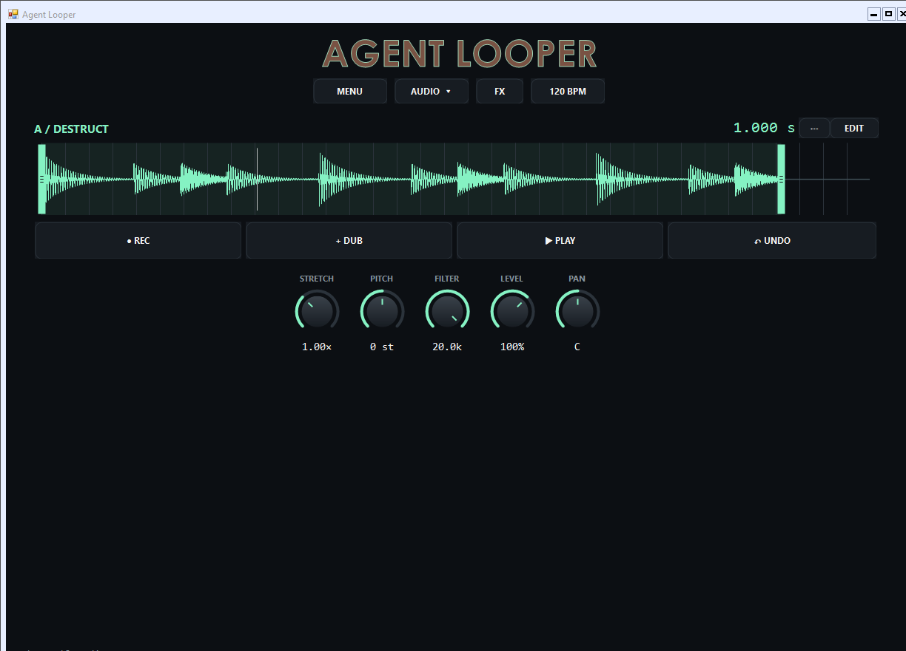

# Agent Looper 1.0

Native Windows audio loop pedal.

[Download Windows 1.0](https://github.com/AveyCole/Agent-Looper/releases/tag/v1.0) · [Portable ZIP](Agent-Looper-Windows.zip) · [Release notes](RELEASE-NOTES.md)

## Start looping

Extract the complete portable ZIP and run **Agent-Looper.exe**. Keep its DLLs, tools and licenses together. Requires Windows x64 and .NET Framework 4.7.2 or later.

New sessions start in **Single + Destructive** mode: one looper with overdubs summed into one layer, like a hardware pedal. MENU → Layout enables the second looper. The looper's menu switches between Destructive and separate Layers. Undo/Redo can recover overdubs, clears and deleted layers.

Choose input channels and an output in AUDIO; changes apply automatically. Hardware ASIO drivers expose the channels reported by the interface, including Zoom L6 inputs. Windows audio supports device-native formats. Avoid doubling software input monitoring with hardware direct monitoring.

Record starts/finishes a take; Overdub adds another pass; Play stops/restarts playback. Auto Overdub can continue recording at each loop boundary. Wait for Input arms recording until the input crosses the threshold. BPM, meter, count-in, click and quantized start options are available in timing and looper menus. Looper B can wait for A's restart and record A or Live + A. The software click is excluded from recordings and internal routing.

## Editing and effects

Drag waveform edge handles to trim or extend the clip. Scroll to zoom, Shift+scroll to pan. EDIT collapses the layer controls. Pitch, stretch, filter, level and pan can be adjusted during playback; Warp synchronizes separate layers to a shared cycle. Destructive mode hides Warp.

Master FX sit beneath the sample controls. Double-click the effect tabs to cycle Hall/Room, Delay/Ping-Pong/POTS, and Granular/Clouds/Cloud Delay. Single-click a selected FX tab to collapse its parameters. Hall has decay and tone; delay has tempo divisions; grains have Freeze, fine Position, switches and dry/wet. The master filter sweeps lowpass on the left and highpass on the right, with bypass at center. Double-click knobs to restore defaults. Right-click supported buttons and knobs for MIDI Learn.

Menus, dropdowns, buttons, displays and scroll rails use the dark app styling. **F11** enters fullscreen; **Escape** or the visible EXIT button leaves it.

## Import and export

MENU → Files imports audio or extracts audio from supported video formats using Windows codecs. WAV, MP3, M4A and FLAC support depends on the installed codec. Imports can be up to ten minutes. Export writes 48 kHz stereo 32-bit float WAV. Export before closing; this Windows version does not save editable sessions.

## Build

Run `powershell -ExecutionPolicy Bypass -File build.ps1 -OutputName Agent-Looper.exe` from the repository root. The ZIP also includes the application source. Keep the native libraries and tools available when running a build. See the bundled license notices and `licenses/native/PROVENANCE.txt` for native dependencies.

Windows UI validation: `Agent-Looper.exe --session-ui-test`. Audio and rendering checks are included in the source; automated checks do not replace listening on your hardware.

## Android

The existing `android/` directory is an older development source snapshot. Android distribution is being prepared separately. **No APK or Android app bundle is provided in this repository or the 1.0 release.**

## License

GPL version 2 or later, consistent with the linked Rubber Band library; see `LICENSE.txt`. Third-party components retain their licenses, including NAudio, Microsoft runtime components, Rubber Band, FFTW and the POTS delay adaptation. All bundled notices are retained.
