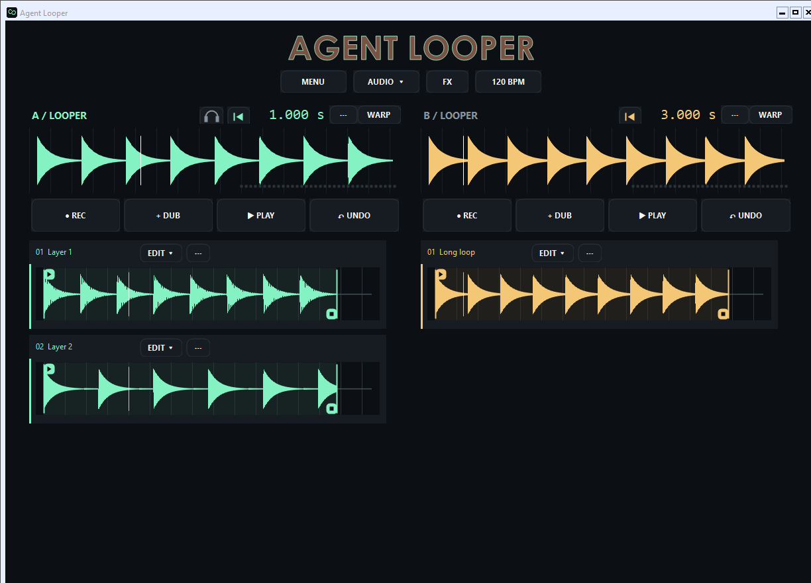

# Agent Looper

Windows 1.2.12 · Mac 1.2.8

**It is happening again...**

Native Windows and Apple Silicon Mac audio loop pedal.

[Download Windows 1.2.12](https://github.com/AveyCole/Agent-Looper/raw/refs/heads/main/Agent-Looper-Windows.zip) · [Download Mac 1.2.8 (Apple Silicon)](https://github.com/AveyCole/Agent-Looper/releases/download/v1.2.8-macos-arm64/Agent-Looper-M1-Mac.zip) · [Portable Windows ZIP](Agent-Looper-Windows.zip) · [Release notes](RELEASE-NOTES.md) · [Download page](https://aveycole.github.io/Agent-Looper/)

## Start looping

Extract the complete portable ZIP and run **Agent-Looper.exe**. Keep its DLLs, tools and licenses together. Requires Windows x64 and .NET Framework 4.7.2 or later.

New sessions start in **Single + Destructive** mode: one looper with overdubs summed into one layer, like a hardware pedal. MENU → Layout enables the second looper. The looper's menu switches between Destructive and separate Layers. Undo/Redo can recover overdubs, clears and deleted layers.

Choose input channels and an output in AUDIO; changes apply automatically. Hardware ASIO drivers expose the channels reported by the interface, including Zoom L6 inputs. Windows audio supports device-native formats. The headphone button in the looper heading toggles software input monitoring. Avoid doubling it with hardware direct monitoring. If ASIO is busy in another app or Agent Looper window, AUDIO explains the conflict and retries automatically.

Record starts/finishes a take; Overdub adds another pass; Play stops/restarts playback. Auto Overdub can continue recording at each loop boundary. Wait for Input arms recording until the input crosses the threshold. BPM, meter, count-in, click and quantized start options are available in timing and looper menus. Both loopers can record the other bank pre/post-FX, Self post-FX, or A+B post-FX, each with a Live + variant. Other-bank sources require Dual mode; internal-only capture needs no selected hardware input. Live + captures separate live/internal layers in Layers mode and sums them in Destructive. FX are baked into the captured pass; destination FX still apply during playback. The software click is excluded from recordings and internal routing.

## Editing and effects

Drag the curved waveform grips to trim or extend the clip: Start has a top play-arrow grip and End has a bottom stop grip. Crossing either grip past the other reverses the selected region; crossing back restores forward playback. Scroll to zoom, Shift+scroll to pan. EDIT collapses the layer controls. EDIT → Truncate to selection discards audio outside the handles, retaining pitch/stretch/reverse/filter/level; Undo/Redo restores/reapplies the crop. The return-to-start icon beside the headphone control resets that bank to the selected region’s beginning while preserving Play/Stop. It is MIDI assignable. Pitch, stretch, filter, level and pan can be adjusted during playback; Warp synchronizes separate layers to a shared cycle. Destructive mode hides Warp.

FX opens a dedicated page. In Dual mode, A SENDS and B SENDS select independent Reverb, Delay, Grain and Filter levels for each looper. Detailed effect settings and routing are shared. Freeze is independent for A and B, with a separate captured grain buffer for each looper. In SERIAL, the tabs run left to right; hold a tab still for one second before dragging it to reorder. Double-click the effect tabs to cycle Hall/Room, Delay/Ping-Pong/POTS, and Granular/Clouds/Cloud Delay. Single-click a selected FX tab to collapse its parameters. Hall has decay and tone; delay has tempo divisions; grains have independent A/B Freeze, fine Position, switches and dry/wet. Grain size spans 2–1,000 ms, Spray extends to 2 seconds, and Spread reaches 200%. CLOUDY has a stronger grain/diffusion range and smoothed live changes, including while frozen. Each looper’s filter sweeps lowpass on the left and highpass on the right, with bypass at center. Double-click knobs to restore defaults. Right-click supported buttons and knobs for MIDI Learn.

Menus, dropdowns, buttons, displays and scroll rails use the dark app styling. **F11** enters fullscreen; **Escape** or the visible EXIT button leaves it.

## Import and export

MENU → Files imports audio or extracts audio from supported video formats using Windows codecs. WAV, MP3, M4A and FLAC support depends on the installed codec. Imports can be up to ten minutes. Export writes 48 kHz stereo 32-bit float WAV. Export before closing; this Windows version does not save editable sessions.

## Build

Run `powershell -ExecutionPolicy Bypass -File build.ps1 -OutputName Agent-Looper.exe` from the repository root. The ZIP also includes the application source. Keep the native libraries and tools available when running a build. See the bundled license notices and `licenses/native/PROVENANCE.txt` for native dependencies.

Windows uses pooled recording blocks to avoid growing-take copies on the audio callback, smooths destructive overdub splices at arbitrary loop positions, and lets silent FX sleep. Recording/playback gain tests remain at unity below overload. Freeze release smoothly splices frozen history into resumed input. Version 1.2.5 strengthens Clouds and Cloud Delay while removing sub-audible DC from the diffusion feedback path.

Windows UI validation: `Agent-Looper.exe --session-ui-test`. Audio and rendering checks are included in the source; automated checks do not replace listening on your hardware.

## Mac (Apple Silicon)

[Download Mac 1.2.8](https://github.com/AveyCole/Agent-Looper/releases/download/v1.2.8-macos-arm64/Agent-Looper-M1-Mac.zip) · [Mac release and checksum](https://github.com/AveyCole/Agent-Looper/releases/tag/v1.2.8-macos-arm64)

Requires macOS 12 or later on Apple Silicon (M1 and newer). Extract the ZIP and open **Agent Looper.app**, then enable AUDIO and allow microphone access. The package contains the app, complete native source, dependency sources/licenses, validation results and an offline rebuild script.

The Mac port follows Windows 1.2.7's interface and features: destructive/layered recording, timing and input triggers, A-to-B routing, independent R3 pitch/stretch, Warp, full master FX, independent sends/Freeze and MIDI Learn. Core Audio replaces Windows audio/ASIO. The Mac additionally retains editable `.agentloop` sessions. The older Android snapshot is not its parity reference.

Regression checks and built-in microphone recording/WAV export passed on the M1 Mac. External MIDI controllers and multichannel interfaces were not physically tested. The app is locally signed, not Apple notarized. See the included README and VALIDATION.txt.

### Mac 1.2.8: internal resampling

Both banks now offer the other bank pre/post-FX, Self post-FX, and A+B post-FX as recording sources, each with a Live + variant. In B’s ⋯ → Input menu choose **Looper A · post-FX** to capture A’s effects. In A choose **Self · post-FX (resample)**, then DUB to capture A as an overdub. Other-bank sources require Dual mode. Internal-only capture works without selected hardware inputs and excludes click/monitoring. Source choices persist in sessions.

FX are baked into captured audio; destination FX still apply during playback. Use Layers to keep the pass separately and mute the original if desired; Destructive adds it to the existing loop. Completed passes join playback at the pass boundary, with no instantaneous feedback path. Repeated automatic resampling overdubs can increase level.

## Android

The existing `android/` directory is an older development source snapshot. Android distribution is being prepared separately. **No APK or Android app bundle is provided in this repository or the Windows download.**

## License

GPL version 2 or later, consistent with the linked Rubber Band library; see `LICENSE.txt`. Third-party components retain their licenses, including NAudio, Microsoft runtime components, Rubber Band, FFTW and the POTS delay adaptation. All bundled notices are retained.
